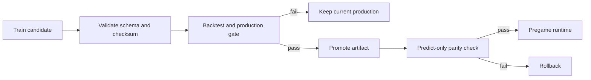

# Model Governance

## 목표

이 프로젝트의 모델 운영 목표는 가장 높은 단일 정확도를 찾는 것이 아니라, 미래 경기에서도 재현 가능한 개선만 production에 반영하는 것입니다.

## 시간적 검증

- 학습과 검증은 경기일 기준으로 분리합니다.
- rolling·expanding 피처는 현재 경기 이전 값만 사용합니다.
- 예측 피처에는 해당 예측 시각 이전에 알 수 있는 정보만 사용합니다.
- 승인 아티팩트의 학습 cutoff와 피처 최신일은 별개입니다. 매일 자동 재학습하지 않습니다.
- validation 기간은 해당 모델 아티팩트에 귀속시킵니다. 구형 아티팩트의 누락 기간은 다른 실행에서 가져오지 않습니다.
- 최신 선수·투수 누적 기록을 과거 경기 학습에 일괄 결합하지 않습니다.

## 평가 지표

| 지표 | 목적 |
| --- | --- |
| Accuracy | 승패 방향 적중률 |
| Brier Score | 확률 오차 |
| Log Loss | 잘못된 고확률 예측에 대한 페널티 |
| Calibration | 예측 확률과 실제 빈도의 일치 |
| Over-55 accuracy | 상대적으로 확신한 구간의 품질 |
| Recent-season accuracy | 최근 환경에서의 성능 유지 |
| Bootstrap CI | 관찰된 개선의 안정성 |

## Production gate

후보 모델은 다음 조건을 함께 검토합니다.

1. 동일 경기의 실제 승인 모델 대비 Accuracy 개선폭이 +0.005를 초과할 것
2. Brier Score와 Log Loss 악화가 각각 +0.001 이내일 것
3. bootstrap 신뢰구간이 개선 방향을 지지할 것
4. calibration 오차 악화가 기존 허용치 +0.005 이내일 것
5. 최근 시즌과 주요 경기 segment가 무너지지 않을 것
6. 데이터 누수 감사에 실패 항목이 없을 것

일부 지표만 좋아진 후보는 challenger로 기록하고 production에는 반영하지 않습니다.

## 2026-10-13 투수 workload 후보 판정

후보 선택은 7월 22일 이전 학습과 이후 선택 구간에서 수행하고, 9월 4일~10월 11일의 124경기 최종 검증에는 고정된 후보만 적용했습니다. 실제 승인 아티팩트를 해당 경기일 이전 데이터로 재현한 비교 결과:

| 지표 | 승인 모델 재현 | 투수 후보 |
| --- | --- | --- |
| Accuracy | 0.6290 (78/124) | 0.6452 (80/124) |
| Brier | 0.2412 | 0.2331 |
| Log Loss | 0.6754 | 0.6592 |
| 양 팀 선발 as-of 확인 111경기 Accuracy | 0.6486 | 0.6486 |

적중률 차이의 날짜 단위 bootstrap 95% CI는 **[-0.0820, +0.1157]**입니다. 0을 포함하므로 안정적인 개선으로 판정하지 않습니다. 13경기는 보관된 공식 시작 시각 레코드가 없어 시점 검증을 완료하지 못했고, 후보용 피처가 현재 team-model 추론 계약에도 모두 구현되어 있지 않습니다.

실패 항목:

- `bootstrap_ci_stable`
- `all_holdout_starter_identities_asof_verified`
- `candidate_features_supported_by_runtime`

이 workload 후보와 기존 투수 **스냅샷** 후보는 서로 다른 실험입니다. 이전 스냅샷 실험의 최소 300경기 요건이나 기존 production gate를 완화한 것이 아닙니다. 재현 확률은 당시 저장된 실시간 확률 로그와도 구분합니다.

따라서 현재 상태는 다음과 같습니다.

```text
safe_to_replace_model = false
safe_to_use_pitching_snapshot_as_features = false
```

이는 데이터가 쓸모없다는 뜻이 아니라, 운영 모델 교체를 정당화할 증거가 아직 부족하다는 뜻입니다.

전체 판정·원천 SHA-256·경기별 비교·시간 감사는 [승격 검토 기록](reviews/PITCHER_PROMOTION_20261013.md)에 있습니다. 이번 검토는 모델을 재선택하거나 최종 검증 구간에 맞춰 튜닝하지 않았습니다.

재검토 순서는 공식 시작 시각 이력 확보, 선발 as-of 입력 계약 구현, 새로운 미사용 경기에서 prospective shadow 검증, 주요 세그먼트·보정·bootstrap·운영 패리티 검증입니다. 이 124경기를 반복 튜닝하여 통과시키는 방식은 허용하지 않습니다.

## 모델과 추천 정책

대시보드의 `추천`, `약우세`, `관망`은 모델 확률을 설명하는 표시 정책입니다. 문구 변경은 모델 성능 개선으로 기록하지 않습니다.

- 승패 확률은 모델 산출값을 유지합니다.
- 추천 등급은 백테스트 구간과 정보 품질을 표시합니다.
- 핸디캡·오버/언더는 유효한 시장 라인이 없으면 `not_available`로 둡니다.
- 사후 결과 감사는 pregame 피처에 사용하지 않습니다.

## Artifact lifecycle



artifact에는 모델 파일뿐 아니라 피처 순서, class 순서, 학습 cutoff, 선택 지표와 승인 상태가 함께 저장됩니다.

## 재현 가능한 보고

주요 판단 근거는 코드가 아니라 결과 파일에도 남깁니다.

- `production_model_gate_audit.json`
- `model_bootstrap_confidence_report.csv`
- `model_calibration_diagnostics_report.csv`
- `non_pitching_feature_leakage_audit.csv`
- `pitching_snapshot_candidate_gate_audit.json`
- `daily_pipeline_health_status.json`

이 구조를 통해 모델을 교체하지 않은 결정도 재검토할 수 있습니다.
